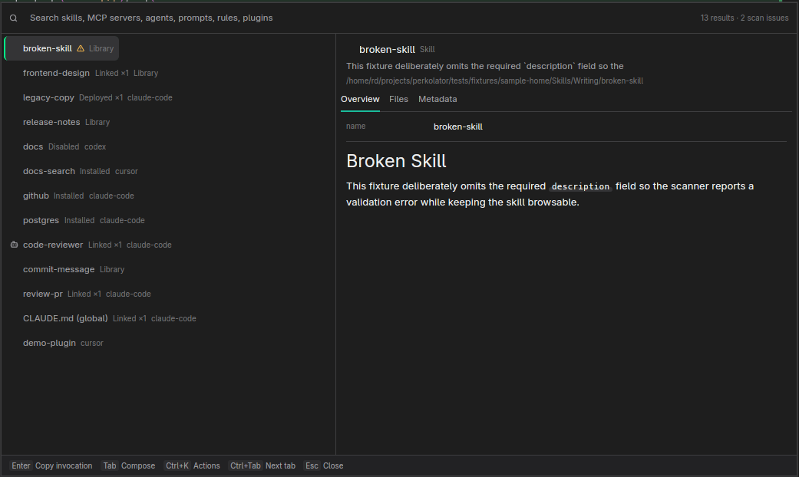

<div align="center">

<p align="center"></p>

  <p align="center">
    <a href="https://www.rust-lang.org/"><picture><source media="(prefers-color-scheme: dark)" srcset="https://shieldcn.dev/badge/Rust%202024.svg?variant=outline&amp;theme=emerald&amp;logo=rust&amp;logoColor=ffffff&amp;mode=auto"></picture></a>
    <a href="https://gpui-kit.com/"><picture><source media="(prefers-color-scheme: dark)" srcset="https://shieldcn.dev/badge/GPUI%20Kit%200.9.svg?variant=outline&amp;theme=emerald&amp;logo=lu%3ALayoutPanelTop&amp;logoColor=ffffff&amp;mode=auto"></picture></a>
    <a href="https://kde.org/plasma-desktop/"><picture><source media="(prefers-color-scheme: dark)" srcset="https://shieldcn.dev/badge/KDE%20Plasma%20Wayland.svg?variant=outline&amp;theme=emerald&amp;logo=kde&amp;logoColor=ffffff&amp;mode=auto"></picture></a>
    <a href="https://www.apple.com/macos/"><picture><source media="(prefers-color-scheme: dark)" srcset="https://shieldcn.dev/badge/macOS%20planned.svg?variant=outline&amp;theme=emerald&amp;logo=apple&amp;logoColor=ffffff&amp;mode=auto"></picture></a>
    <a href="#license"><picture><source media="(prefers-color-scheme: dark)" srcset="https://shieldcn.dev/badge/Apache%202.0-emerald.svg?variant=outline&amp;logo=ri%3ATbBrandOpenSource&amp;mode=dark"></picture></a>
  </p>
  <p align="center"><strong>Search, preview and safely deploy skills, MCP servers, agents, prompts, rules and plugins from one keyboard-first launcher.</strong></p>
  <p align="center">
    <a href="#quick-start">Quick Start</a> | <a href="#launcher">Launcher</a> |
    <a href="#marketplaces">Marketplaces</a> | <a href="#cli">CLI</a> |
    <a href="#configuration">Configuration</a> | <a href="#development">Development</a> |
    <a href="#license">License</a>
  </p>
</div>


---

<a name="quick-start"></a>

##  Quick Start

Requires a stable Rust toolchain (pinned by `rust-toolchain.toml`) on Linux. Indexing is
**read-only**: Perkolator scans your agent folders and configs but never writes to them,
runs discovered scripts, or contacts the network unless you turn marketplaces on.

```bash
git clone https://github.com/deathrashed/perkolator.git
cd perkolator
cargo build -p perkolator          # GPUI desktop app + quick launcher
cargo build -p perkolator-cli      # headless `perk` CLI

# Try it on the bundled sample home first
./target/debug/perkolator --home tests/fixtures/sample-home
./target/debug/perk --home tests/fixtures/sample-home scan
```

Run `perkolator` without `--home` to index your real home. A second `perkolator --toggle`
shows or hides the launcher of the running instance.

> [!IMPORTANT]
> The GPUI build needs several GB of disk. If `/home` is tight, point `CARGO_TARGET_DIR` at a
> larger volume. Deployments only ever change disk with `perk deploy … --apply --yes`; every
> other command is a dry run.

<a name="launcher"></a>

##  Launcher

A dense split view: results on the left, a live, inert preview on the right (`SKILL.md`,
nested references, scripts, MCP config with secrets redacted, prompt variables, rule scope,
plugin permissions). Local results appear instantly; marketplace results stream in below.

<p align="center">
  
</p>

| Key | Action |
| --- | --- |
| Type | Fuzzy search; prefix with `skill:` `mcp:` `agent:` `prompt:` `rule:` `plugin:` or `@installed` |
| `Up` / `Down`, `PgUp` / `PgDn` | Move the selection; the preview follows |
| `Enter` | Default action for the selection (copy invocation, copy config, expand template…) |
| `Tab` | Compose a query with the selected resource and preview the exact text |
| `Ctrl+K`, `Ctrl+Enter` | Action menu; unavailable actions show the reason |
| `Ctrl+S` | Source selector (`Space` toggles, `Enter` applies, `Esc` cancels) |
| `Ctrl+Tab` / `Ctrl+Shift+Tab` | Next / previous preview tab |
| `Ctrl+Down` / `Ctrl+Up` | Step through files in the Files tab |
| `Ctrl+1` / `Ctrl+2` / `Ctrl+3` | Compact / Split / Expanded layout |
| `Esc` | Close the menu, leave compose, close the file, then dismiss — the query is kept |

On KDE Plasma Wayland the launcher is a layer-shell overlay. Insertion into other apps is
not possible under Wayland, so compose and copy actions put the text on the clipboard and
say so.

<details>
<summary><strong>Resource kinds</strong></summary>

| Kind | Found in | Preview | Typical actions |
| --- | --- | --- | --- |
|  **Skill** | `~/Skills`, `~/.agents/skills`, agent `skills/` folders | `SKILL.md`, file tree, metadata | Copy invocation, copy path, compose, deploy |
|  **MCP server** | `~/.claude.json`, `.mcp.json`, Cursor, Codex and OpenCode configs | Redacted config, declared tools | Copy configuration, copy config file path |
|  **Agent** | `~/.claude/agents/*.md` | Profile body, model, tools | Copy invocation, compose |
|  **Prompt** | `~/.claude/commands`, prompt libraries | Template and variables | Expand template, copy contents |
|  **Rule** | `AGENTS.md`, `CLAUDE.md`, `GEMINI.md`, `.cursor/rules/*.mdc` | Body, scope and precedence | Copy contents |
|  **Plugin** | `.cursor-plugin/` and `.claude-plugin/` manifests | Components, executable files, content hash | Copy path, inspect permissions |

Nothing in a preview is executed. Plugin hooks and MCP stdio servers are listed, never run.

</details>

<a name="marketplaces"></a>

##  Marketplaces

Remote search is **off until you enable it** in the source selector (`Ctrl+S`). Enabled
sources are queried concurrently with per-source timeouts; one failing source never hides
the others, and results from several sources pointing at the same repository are merged
with every source kept.

| Source | Kinds | Status |
| --- | --- | --- |
| [Official MCP Registry](https://registry.modelcontextprotocol.io/docs) | MCP | Working, anonymous |
| SkillsMP · VoltAgent skills | Skills | Working, anonymous |
| prompts.chat | Prompts, agents | Working, anonymous |
| GitHub direct | All six | Working; paste `owner/repo` or a GitHub URL |
| Claude plugins · Cursor plugins · wshobson/agents | Plugins, skills, agents, rules, MCP | Working; hooks flagged, never run |
| VoltAgent subagents | Agents | Working |
| OfficialSkills · Awesome Claude Code | Skills, mixed | Metadata only (links) |
| skills.sh · LobeHub · Glama · PulseMCP | Mixed | Needs credentials or partner access |
| Smithery | MCP | Blocked by provider (search returns HTTP 500) |

Remote results are metadata: Enter copies the source URL, and the action menu can open it
or copy a package reference. Nothing is downloaded or installed from a listing.

<details>
<summary><strong>Credentials and source settings</strong></summary>

Sources that accept keys read them from the environment for now: `PERKOLATOR_TOKEN_<SLOT>`
(slot upper-cased, `-` → `_`, e.g. `PERKOLATOR_TOKEN_GLAMA`) or `GITHUB_TOKEN` for GitHub.
Keys are never written to settings, logs or results.

Your enable/disable choices are saved to `~/.config/perkolator/marketplaces.toml`. Bundled
defaults come from [`config/marketplace-providers.example.toml`](config/marketplace-providers.example.toml);
Glama, PulseMCP, skills.sh and Smithery start disabled. See
[`docs/MARKETPLACE_INTEGRATION.md`](docs/MARKETPLACE_INTEGRATION.md) and
[`docs/MARKETPLACE_AUTH.md`](docs/MARKETPLACE_AUTH.md) for the full design.

</details>

<a name="cli"></a>

##  CLI

```bash
# Inspect what is installed (read-only)
perk scan
perk search "mcp: git"
perk show frontend-design
perk validate

# Plan a deployment; nothing changes on disk
perk deploy frontend-design --target claude-code --target codex --target cursor

# Apply it after reviewing the plan
perk deploy frontend-design --target claude-code --target codex --target cursor \
  --apply --yes
```

| Command | Effect |
| --- | --- |
| `scan`, `list`, `search`, `show` | Inventory, fuzzy search and preview summaries (`--json` where noted) |
| `validate [--strict]` | Report skill/frontmatter issues; nonzero exit on errors |
| `actions ID`, `copy ID ACTION` | List actions, or print an action's clipboard text (secrets redacted) |
| `targets` | Built-in agent targets with resolved skill folders and detection |
| `deploy ID --target T…` | Plan symlink, managed-copy, link-source or independent-copy deployment |
| `undeploy DEST`, `repair DEST` | Remove or re-point only deployments Perkolator owns |
| `recover`, `status`, `matrix` | Finish interrupted runs; show deployments and the skill × agent matrix |

Global options: `--home DIR`, `--project DIR` (repeatable) and `--state-dir DIR`.

> [!TIP]
> Existing folders you created yourself are never overwritten or removed: a plan that would
> touch one is refused as a whole.

<a name="configuration"></a>

##  Configuration

| Setting | Purpose |
| --- | --- |
| `~/.config/perkolator/marketplaces.toml` | Marketplace master switch and per-source enable flags |
| `<home>/.local/state/perkolator/` | Deployment manifest (`manifest.json`) and operation journal |
| `$XDG_RUNTIME_DIR/perkolator.sock` | Single-instance socket used by `perkolator --toggle` |
| `PERKOLATOR_PROJECTS` | Extra project roots to index (path list) |
| `PERKOLATOR_LAYER_SHELL=0` | Use a normal popup window instead of a layer-shell overlay |
| `PERKOLATOR_LAYER_KEYBOARD=on-demand` | Let other windows take focus while the launcher is open |
| `PERKOLATOR_DEBUG=1` | Log index, search and window-open timings to stderr |

<details>
<summary><strong>Global shortcut on KDE Plasma</strong></summary>

When the desktop portal does not offer GlobalShortcuts, bind the launcher manually:
**System Settings → Keyboard → Shortcuts → Add New → Command or Script**, command
`perkolator --toggle`. `perkolator --print-desktop-entry` prints a `.desktop` file with a
*Toggle Quick Launcher* action you can install yourself.

</details>

##  Structure

```text
perkolator/
├── apps/
│   ├── desktop/                 # GPUI app: quick launcher, IPC toggle, theme bridge
│   └── cli/                     # Headless `perk` CLI
├── crates/
│   ├── core/                    # Resource ids, six typed kinds, capabilities, actions
│   ├── registry/                # Read-only local discovery and normalisation
│   ├── search/                  # Nucleo fuzzy index and query syntax
│   ├── preview/                 # Inert, cancellable previews with redaction
│   ├── actions/                 # Capability-gated actions, composer, templates
│   ├── targets/                 # Agent target registry (skill folder paths)
│   ├── deployment/              # Dry-run-first, journalled, recoverable deploys
│   ├── marketplace/             # Provider contract, scheduler, cache, dedup
│   ├── providers/               # 16 marketplace source adapters
│   ├── theme/                   # Versioned theme schema, dark/light themes
│   └── platform-linux/          # KDE Wayland capability probes, desktop entry
├── config/                      # Example app, theme and marketplace settings
├── docs/                        # Plan, architecture, ADRs, status, platform checklists
└── tests/fixtures/sample-home/  # Fake home used by tests and demos
```

<a name="development"></a>

##  Development

```bash
cargo fmt --all -- --check
cargo test                                   # headless crates and CLI
cargo test -p perkolator                     # desktop crate (builds GPUI)
cargo clippy --all-targets -- -D warnings
```

Tests run against temporary copies of `tests/fixtures/sample-home` and offline HTTP/CLI
fixtures; they never touch real agent folders or the network. Live marketplace checks are
`#[ignore]` tests: `cargo test -p perkolator-providers -- --ignored`.

<details>
<summary><strong>Project status and platform notes</strong></summary>

Verified on CachyOS with KDE Plasma / KWin 6.8.2 (Wayland). macOS has not been built or run
yet. Current results, known gaps and measurements are tracked in
[`docs/progress/STATUS.md`](docs/progress/STATUS.md); design decisions live in
[`docs/adr/`](docs/adr/). Contributors and coding agents start with [`AGENTS.md`](AGENTS.md)
and [`docs/IMPLEMENTATION_PLAN.md`](docs/IMPLEMENTATION_PLAN.md).

</details>

<a name="license"></a>

## <a href="https://www.apache.org/licenses/LICENSE-2.0"></a> License

<div align="center">

[**𝗔𝗣𝗔𝗖𝗛𝗘 𝗟𝗜𝗖𝗘𝗡𝗦𝗘**](https://raw.githubusercontent.com/deathrashed/gupload/refs/heads/main/uploads/files/licenses/apache/LICENSE)

<a href="https://raw.githubusercontent.com/deathrashed/gupload/refs/heads/main/uploads/files/licenses/apache/LICENSE"></a>

**𝗖𝗢𝗣𝗬𝗥𝗜𝗚𝗛𝗧 © 𝟮𝟬𝟮𝟲 𝗗𝗘𝗔𝗧𝗛𝗥𝗔𝗦𝗛𝗘𝗗**

</div>
